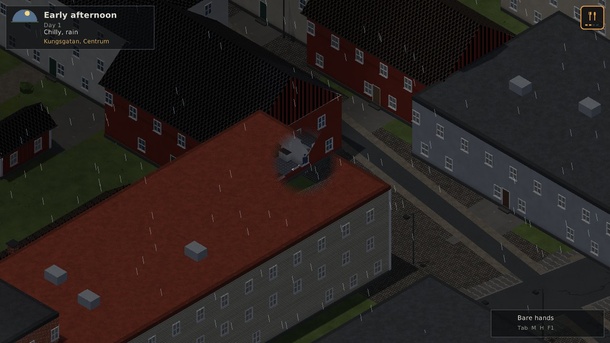
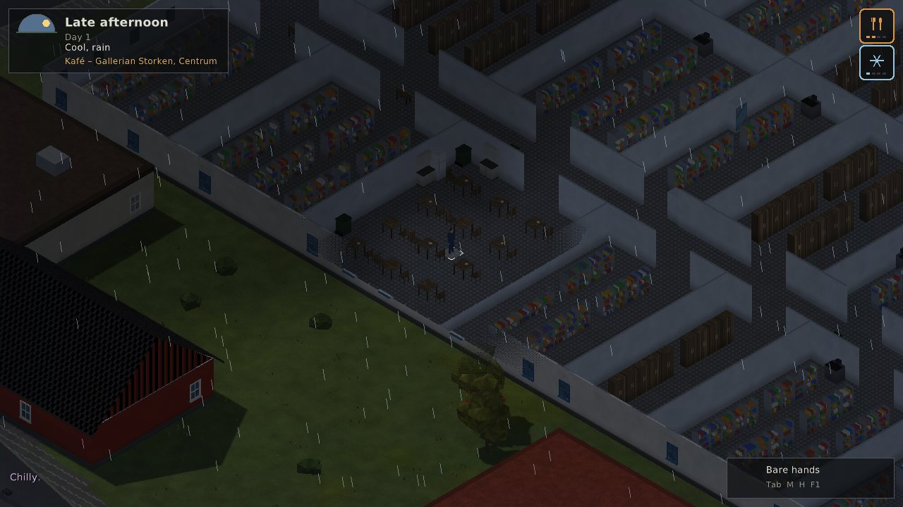
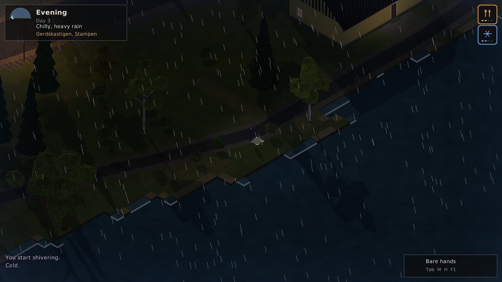

# Alone

An isometric 3D survival game set in **Alingsås, Sweden**, inspired by
*Project Zomboid*. Everyone is gone. Hunt, eat, search, loot, fight, survive -
and listen to your body, because it will tell you *how* you feel but never
*why*.


| | |
|---|---|
|  |  |
|  |  |
|  |  |
|  |  |
|  |  |

**The player** is a bone-based rig with procedural animations
([MP4](docs/media/character_animations.mp4)):


> Early prototype (v0.1). The game was originally an NDS project; it has been
> rewritten from scratch in C++17 for PC (Linux and Windows).

## What's in it

**A real place.** Alingsås is built from OpenStreetMap data: more than 4,000
real buildings with their real size and use, every named street, footpath and
forest track, the railway and the station, parks, car parks, squares, single
trees and street lamps. Lake Mjörn, Gerdsken and Säveån winding through
Nolhaga; Christinae kyrka; the hospital; the E20. **Gallerian Storken** in the
centre is a two-storey shopping centre with walkways, shop units (clothes,
shoes, a watchmaker, electronics, books, sport & outdoor, Systembolaget, a
pharmacy, a grocer) and a food court where you can find leftover burgers,
cold fries and kebab - edible, if you're desperate and lucky. Forests are as
thick as the real ones around town. One tile is one metre; the map covers
about 9.4 x 5.3 km. Interiors, furniture and loot are generated
deterministically on top of the real footprints, and areas outside the
mapped part are filled in procedurally.

**Light.** Sun and moon cast real shadows; at night street lamps, lit windows
and flickering TVs make warm pools of light (while the power lasts - it goes
out within the first two weeks). A flashlight cone, see-through walls around
you, wet ground after rain and snow cover in winter.

**Know only what you can know.** There's no clock on screen until you find a
wristwatch or an alarm clock - before that you only see roughly what part of
the day it is from the sun. The temperature is "Chilly" or "Freezing" until you
carry a thermometer.

**A body that works like a body.** The survival model tracks real quantities:
stomach contents, blood sugar, liver and muscle glycogen, body fat, lean mass,
free amino acids, the liver's urea capacity, ammonia, ketosis adaptation,
vitamin C stores, hydration, blood volume, core temperature (with clothing
insulation, wetness, wind, shivering and sweating), sleep pressure, wounds,
infections and toxins. Some consequences:

* **Rabbit starvation is real.** Hare and roe deer are very lean. Live on them
  alone and you exceed what your liver can process: you stay hungry however
  much you eat, then come nausea, diarrhoea, weakness - and death within a
  week or two. Add fat (butter, lard, boar back fat, deer tallow) and you're
  fine.
* Lean people burn muscle sooner when starving; fat can only be released so fast.
* No vitamin C for two months and your gums start to bleed (scurvy). Rose hips,
  lingonberries, raw liver, potatoes and tablets help.
* Untreated lake water can give you Giardia days later. Raw hare can carry
  tularemia ("harpest"), undercooked wild boar trichinosis, spoiled food food
  poisoning.
* Some white mushrooms are field mushrooms. Some are death caps: you feel sick
  the next day, then better... then your liver fails. A mushroom field guide
  in your pack tells them apart.
* Wet clothes in the wind kill. So does an untreated deep wound.

**Symptoms, not diagnoses.** The HUD shows how you feel - *Feeling queasy*,
*Queasy*, *Nauseous*, *Retching*; *Chilly*, *Cold*, *Freezing*, *Numb with cold*;
*Craving*, *Bleeding gums*, *Yellowish skin*... Hover over a symptom to read
what it feels like. The cause is only revealed after death. All symptom text
lives in `data/text/symptoms.ini`.

**Things to do:** search kitchens, wardrobes, sheds, shops, the pharmacy and the
hospital; eat (all, half, a quarter) and drink; open cans (or pry them open with
a knife and maybe cut yourself); fill bottles at lakes, toilet tanks and rain
barrels; boil or purify water; pick lingonberries, blueberries and rose hips;
forage for mushrooms; gather sticks, chop trees, build and light campfires,
cook; set snares for hares; hunt hare, roe deer, wild boar and moose with melee
weapons or a moose rifle; butcher carcasses; bandage and disinfect wounds; take
painkillers, antibiotics and vitamins; wear clothing for warmth and rain;
sleep (beds are warmer); read the map.

**Saving:** the game autosaves every few minutes and when you quit; continue
from the main menu. Death is permanent - the save goes with you.

**Sound:** the soundtrack (`data/assets/audio/`) plays in the background with
pauses in between. When something hunts you, the music cross-fades to the
danger tracks in `data/assets/audio/danger/` (prompts for making them are in
[docs/music_prompts.md](docs/music_prompts.md)). Rain, wind, campfires,
footsteps, gunshots, doors and the rest are synthesised on the fly.

**Items:** ~90 items with real nutrition values per 100 g (from food
composition tables), defined in plain text in `data/items/*.ini`. Store food has
a nutrition label you can read; wild food doesn't.

## Building

The game uses [raylib](https://www.raylib.com) 5.5, which CMake downloads
automatically. You need CMake 3.16+ and a C++17 compiler.

### Linux

```sh
sudo apt install build-essential cmake git \
    libx11-dev libxrandr-dev libxinerama-dev libxcursor-dev libxi-dev libgl1-mesa-dev libasound2-dev
./scripts/build-linux.sh        # builds, runs the tests
./build/alone
```

### Windows

With Visual Studio 2019 or newer (Desktop development with C++) and CMake:

```bat
scripts\build-windows.bat
build\Release\alone.exe
```

Or cross-compile from Linux with MinGW-w64 (`sudo apt install mingw-w64`):

```sh
./scripts/build-windows-cross.sh   # -> build-windows/alone.exe + data/
```

The `data/` folder must sit next to the executable (the build copies it).

### Options

* `-DALONE_BUILD_CLIENT=OFF` builds only the backend library and tests (no graphics).
* `alone --debug` enables the F3 debug overlay with the real body values.
* `alone --seed N` picks a world seed; `--data DIR` points to another data folder.
* `alone --screenshots` runs an automated tour and saves screenshots (used as a smoke test in CI).
  `ALONE_SHOTS=storken,forest` limits it to some stops.
* `alone --anim-showcase DIR` renders the character animations to PNG frames
  (`ffmpeg -framerate 30 -i DIR/frame_%04d.png out.mp4`).

## Controls

| Key | Action |
|---|---|
| W A S D | Walk (Shift run, Ctrl sneak) |
| Right click | Interact with what's under the cursor |
| F | Quick interact (doors, search) |
| Left click / Space | Attack with what you hold |
| Tab / I | Inventory - double-click moves items, right-click for options |
| H | Look yourself over (wounds, build) |
| M | Map |
| Z / R | Sleep / rest for an hour |
| L | Flashlight |
| Q / E, wheel | Rotate / zoom camera |
| 1 / 2 / 3 | Time x1 / x5 / x20 |
| Esc | Pause |

A day lasts 24 real minutes by default (changeable in Settings).

## Project layout

```
src/core/       logging, config files, noise, random numbers, paths
src/survival/   Body (the physiology model), Symptoms
src/items/      item definitions, instances, inventory, loot tables
src/world/      map data, terrain zones, buildings & interiors, chunks, clock & weather
src/game/       Game (simulation, actions, combat), wildlife AI
src/client/     raylib renderer, UI, app (menus, HUD, inventory, map)
tests/          unit tests for the backend (diet scenarios, world, gameplay)
data/           everything moddable: items, loot, animals, symptoms, map, shaders, fonts, music
tools/mapgen/   digitize.py: map image -> terrain + roads; osm_import.py: OpenStreetMap -> buildings, streets, land use
tools/worlddump world generation preview tool
```

The backend (`alone_core`) has no graphics dependency, so the whole simulation
can be tested headless (`ctest`).

### The map pipeline

`tools/mapgen/digitize.py <map image> <out dir>` classifies every pixel of a
map image into land cover (water, forest, woodland, park, residential, field,
meadow, commercial, hospital), removes labels and icons, recovers the river
under the municipal border line, and vectorises the road network. The output
(`terrain.pgm`, `roads.txt`) plus hand-placed `features.txt` (railway, centre
streets, plazas, landmarks, district names) and `map.ini` make up a map. A
procedural Sweden can later generate the same files.

`tools/mapgen/osm_import.py <map dir> <file.osm[.gz]>...` adds the detail from
OpenStreetMap exports (the Alingsås ones are in `tools/mapgen/osm/alingsas/`).
It aligns them to the map with the named points in `anchors.txt`, then writes
a 2 m land-use grid (`terrain2m.pgm`), named streets and paths in metres
(`roads_m.txt`) and every building, tree and street lamp
(`osm_features.txt`). Building use comes from OSM tags and the shops and
amenities inside each building.

## Roadmap

* Procedural Swedish countryside beyond the map edge
* Upper floors, basements, more building types (farms, summer cottages)
* Fishing, trapping more animals, preserving food (smoking, drying, salting)
* Other survivors

## License

GPL-3.0 (see `LICENSE`). Fonts: DejaVu (see `data/fonts/LICENSE-DejaVu.txt`).
raylib is zlib-licensed. Map data © OpenStreetMap contributors, available
under the Open Database License (ODbL).
