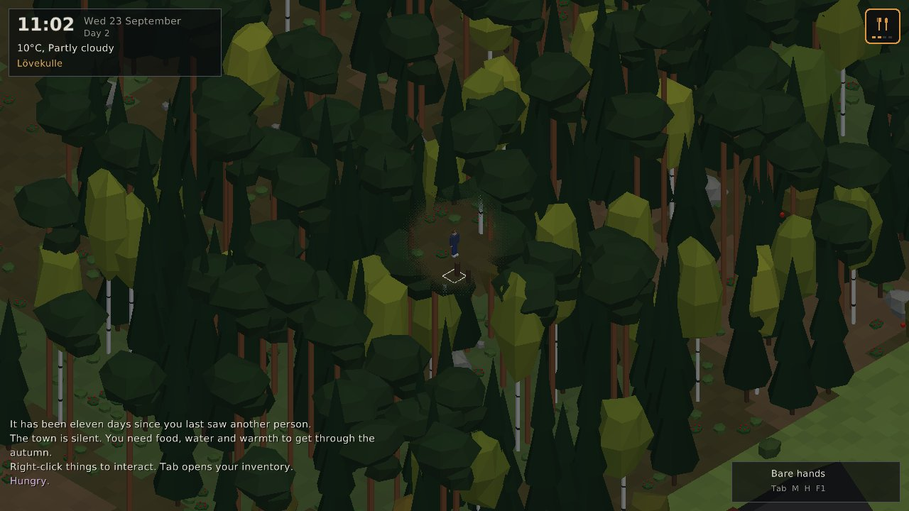

# Alone

An isometric 3D survival game set in **Alingsås, Sweden**, inspired by
*Project Zomboid*. Everyone is gone. Hunt, eat, search, loot, fight, survive -
and listen to your body, because it will tell you *how* you feel but never
*why*.


| | |
|---|---|
|  |  |
|  |  |

> Early prototype (v0.1). The game was originally an NDS project; it has been
> rewritten from scratch in C++17 for PC (Linux and Windows).

## What's in it

**A real place.** The map is digitised from a map of Alingsås: Lake Mjörn,
Gerdsken, Säveån winding through Nolhaga, the E20, the railway (Västra
stambanan) and the station, the old-town street grid around Stora torget,
Christinae kyrka, the hospital, Villa Plantaget, and the districts around them
(Noltorp, Nygård-Nolby, Stadsskogen-Tuvebo, Gråbo, Ängabo...). One tile is one
metre; the map covers about 9.4 x 5.3 km. Buildings, furniture, trees and loot
are generated deterministically on top of it.

**A body that works like a body.** The survival model tracks real quantities:
stomach contents, blood sugar, liver and muscle glycogen, body fat, lean mass,
free amino acids, the liver's urea capacity, ammonia, ketosis adaptation,
vitamin C stores, hydration, blood volume, core temperature (with clothing
insulation, wetness, wind, shivering and sweating), sleep pressure, wounds,
infections and toxins. Some consequences:

* **Rabbit starvation is real.** Hare and roe deer are very lean. Live on them
  alone and you exceed what your liver can process: you stay hungry however
  much you eat, then come nausea, diarrhoea, weakness - and death within a
  week or two. Add fat (butter, lard, boar back fat, deer tallow) and you're
  fine.
* Lean people burn muscle sooner when starving; fat can only be released so fast.
* No vitamin C for two months and your gums start to bleed (scurvy). Rose hips,
  lingonberries, raw liver, potatoes and tablets help.
* Untreated lake water can give you Giardia days later. Raw hare can carry
  tularemia ("harpest"), undercooked wild boar trichinosis, spoiled food food
  poisoning.
* Some white mushrooms are field mushrooms. Some are death caps: you feel sick
  the next day, then better... then your liver fails. A mushroom field guide
  in your pack tells them apart.
* Wet clothes in the wind kill. So does an untreated deep wound.

**Symptoms, not diagnoses.** The HUD shows how you feel - *Feeling queasy*,
*Queasy*, *Nauseous*, *Retching*; *Chilly*, *Cold*, *Freezing*, *Numb with cold*;
*Craving*, *Bleeding gums*, *Yellowish skin*... Hover over a symptom to read
what it feels like. The cause is only revealed after death. All symptom text
lives in `data/text/symptoms.ini`.

**Things to do:** search kitchens, wardrobes, sheds, shops, the pharmacy and the
hospital; eat (all, half, a quarter) and drink; open cans (or pry them open with
a knife and maybe cut yourself); fill bottles at lakes, toilet tanks and rain
barrels; boil or purify water; pick lingonberries, blueberries and rose hips;
forage for mushrooms; gather sticks, chop trees, build and light campfires,
cook; set snares for hares; hunt hare, roe deer, wild boar and moose with melee
weapons or a moose rifle; butcher carcasses; bandage and disinfect wounds; take
painkillers, antibiotics and vitamins; wear clothing for warmth and rain;
sleep (beds are warmer); read the map.

**Saving:** the game autosaves every few minutes and when you quit; continue
from the main menu. Death is permanent - the save goes with you.

**Sound:** your music plays in the background; rain, wind, campfires,
footsteps, gunshots, doors and the rest are synthesised on the fly, so the
game needs no sound files.

**Items:** ~90 items with real nutrition values per 100 g (from food
composition tables), defined in plain text in `data/items/*.ini`. Store food has
a nutrition label you can read; wild food doesn't.

## Building

The game uses [raylib](https://www.raylib.com) 5.5, which CMake downloads
automatically. You need CMake 3.16+ and a C++17 compiler.

### Linux

```sh
sudo apt install build-essential cmake git \
    libx11-dev libxrandr-dev libxinerama-dev libxcursor-dev libxi-dev libgl1-mesa-dev libasound2-dev
./scripts/build-linux.sh        # builds, runs the tests
./build/alone
```

### Windows

With Visual Studio 2019 or newer (Desktop development with C++) and CMake:

```bat
scripts\build-windows.bat
build\Release\alone.exe
```

Or cross-compile from Linux with MinGW-w64 (`sudo apt install mingw-w64`):

```sh
./scripts/build-windows-cross.sh   # -> build-windows/alone.exe + data/
```

The `data/` folder must sit next to the executable (the build copies it).

### Options

* `-DALONE_BUILD_CLIENT=OFF` builds only the backend library and tests (no graphics).
* `alone --debug` enables the F3 debug overlay with the real body values.
* `alone --seed N` picks a world seed; `--data DIR` points to another data folder.
* `alone --screenshots` runs an automated tour and saves screenshots (used as a smoke test in CI).

## Controls

| Key | Action |
|---|---|
| W A S D | Walk (Shift run, Ctrl sneak) |
| Right click | Interact with what's under the cursor |
| F | Quick interact (doors, search) |
| Left click / Space | Attack with what you hold |
| Tab / I | Inventory - double-click moves items, right-click for options |
| H | Look yourself over (wounds, build) |
| M | Map |
| Z / R | Sleep / rest for an hour |
| L | Flashlight |
| Q / E, wheel | Rotate / zoom camera |
| 1 / 2 / 3 | Time x1 / x5 / x20 |
| Esc | Pause |

A day lasts 24 real minutes by default (changeable in Settings).

## Project layout

```
src/core/       logging, config files, noise, random numbers, paths
src/survival/   Body (the physiology model), Symptoms
src/items/      item definitions, instances, inventory, loot tables
src/world/      map data, terrain zones, buildings & interiors, chunks, clock & weather
src/game/       Game (simulation, actions, combat), wildlife AI
src/client/     raylib renderer, UI, app (menus, HUD, inventory, map)
tests/          unit tests for the backend (diet scenarios, world, gameplay)
data/           everything moddable: items, loot, animals, symptoms, map, shaders, fonts, music
tools/mapgen/   digitize.py: turns a map image into terrain + roads
tools/worlddump world generation preview tool
```

The backend (`alone_core`) has no graphics dependency, so the whole simulation
can be tested headless (`ctest`).

### The map pipeline

`tools/mapgen/digitize.py <map image> <out dir>` classifies every pixel of a
map image into land cover (water, forest, woodland, park, residential, field,
meadow, commercial, hospital), removes labels and icons, recovers the river
under the municipal border line, and vectorises the road network. The output
(`terrain.pgm`, `roads.txt`) plus hand-placed `features.txt` (railway, centre
streets, plazas, landmarks, district names) and `map.ini` make up a map. A
procedural Sweden can later generate the same files.

## Roadmap

* Procedural Swedish countryside beyond the map edge
* Upper floors, basements, more building types (farms, summer cottages)
* Fishing, trapping more animals, preserving food (smoking, drying, salting)
* Other survivors

## License

GPL-3.0 (see `LICENSE`). Fonts: DejaVu (see `data/fonts/LICENSE-DejaVu.txt`).
raylib is zlib-licensed.
